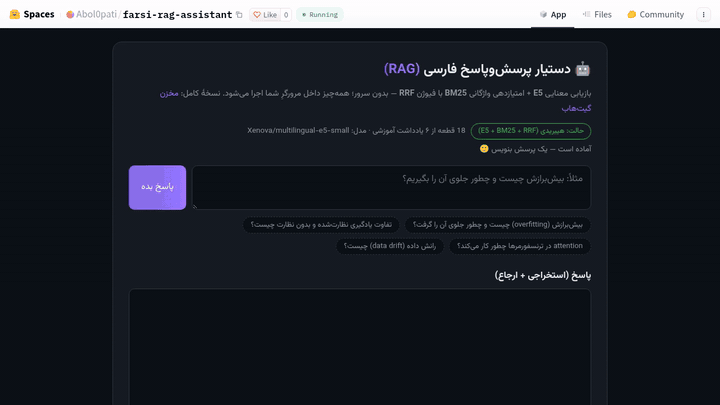

# Machine Learning

[](https://github.com/Abolfazlrwm/Machine-Learning/actions) [](https://abolfazlrwm.github.io/Machine-Learning/) [](https://huggingface.co/spaces/Abol0pati/farsi-rag-assistant) [](LICENSE)

[](https://github.com/Abolfazlrwm/Machine-Learning/actions/workflows/tests.yml)

A collection of end-to-end machine learning projects — from classical
scikit-learn pipelines to LLM-powered retrieval. Every project ships with a
structured codebase (`src/` + `tests/`), real evaluation numbers and a
documented methodology.

<p align="center"></p>


## 🗂 Projects

| Project | Domain | Key techniques | Headline result |
|---|---|---|---|
| [`rag-farsi-assistant`](rag-farsi-assistant/) | LLM / Retrieval (RAG) | Persian RAG: E5 embeddings + FAISS **fused with a from-scratch BM25 via RRF**, bilingual query expansion (Persian <-> English), exact + semantic (paraphrase-aware) answer cache, per-stage traces + **Prometheus metrics**, switchable dense/sparse/hybrid modes, re-rank stage (offline lexical / neural cross-encoder), **bilingual prompt-injection guardrails**, RAGAS-style eval suite, Ollama/OpenAI providers, Streamlit chat | 30-pair golden set: hybrid Hit@1 = 0.967, MRR = 0.983 (E5+BM25 via RRF) · context recall 0.98 · 162 tests |
| [`ai-text-detector`](ai-text-detector/) | NLP classification | TF-IDF + stylometric features (sentence length variation, punctuation habits), Linear SVM vs NB vs LR | Accuracy 0.897 · F1 0.899 · ROC-AUC 0.964 |
| [`recommender-system`](recommender-system/) | RecSys | User-based & item-based collaborative filtering **from scratch** (pandas/NumPy) on MovieLens 105k | User-CF RMSE 0.877 · Item-CF RMSE 0.925 |
| [`stock-movement-ml`](stock-movement-ml/) | Finance / time series | 20 technical indicators, walk-forward validation, leakage-free backtest with costs, Plotly dashboard | OOS ROC-AUC 0.53 (Random Forest), +25.45% on 696 out-of-sample days |
| [`sms-spam`](sms-spam/) | NLP baseline | TF-IDF (1–2 grams) + Logistic Regression, 5-fold GridSearchCV | Accuracy 0.975 · ROC-AUC 0.987 |

## 🧭 What each project demonstrates

- **rag-farsi-assistant** — the full modern RAG loop: chunking with overlap,
  multilingual embeddings (E5 with automatic query/passage prefixes), FAISS
  vector search, **hybrid retrieval that fuses dense + BM25 rankings with
  Reciprocal Rank Fusion (BM25 implemented from scratch, Persian-aware
  tokenisation)**, optional cross-encoder re-ranking, strict Persian prompts
  that force citation and "I don't know" behaviour, and a provider layer that
  swaps **Ollama (local, free) ⇄ any OpenAI-compatible API** with one line.
  Evaluated like production: a 30-pair golden set, dense-vs-sparse-vs-hybrid
  comparison and a deterministic RAGAS-style generation suite — hybrid
  retrieval wins with Hit@1 0.967 / MRR 0.983. Queries pass through a
  bilingual understanding layer (script-mix profiling + cross-language
  synonym expansion feeding BM25 only — the evaluated E5 behaviour is
  untouched), answers are memoised in a TTL+LRU cache, and every stage
  emits timings that render as **Prometheus metrics** at the API's
  `/v1/metrics`. A re-rank stage refines the fused ranking — a
  deterministic lexical scorer in CI (lifts hybrid hit@1 0.80 → 0.90 on
  the reproducible baseline) or a neural cross-encoder (e.g.
  BAAI/bge-reranker-v2-m3) in production — and **bilingual
  prompt-injection guardrails** screen every question with flag/block
  policies (OWASP LLM01). Ships a Streamlit chat UI, CLI, and a
  dependency-free "fake" embedding backend for CI; full docs live at the
  [documentation site](https://abolfazlrwm.github.io/Machine-Learning/).
- **ai-text-detector** — classic feature engineering: does *style* reveal
  machine text better than *vocabulary*? Hybrid TF-IDF + stylometric features
  beat plain TF-IDF across all three classifiers.
- **recommender-system** — collaborative filtering implemented from first
  principles (similarity matrices, weighted predictions, RMSE/MAE evaluation),
  no recommendation libraries.
- **stock-movement-ml** — financial ML done honestly: walk-forward
  validation instead of a single split, signals aligned to next-day returns,
  transaction costs, and results reported *including* the uncomfortable ones
  (daily direction ≈ coin flip).

## 🚀 Quick start

Each project is self-contained with its own `requirements.txt` and README:

```bash
# RAG assistant (needs an Ollama model or an OpenAI-compatible key)
cd rag-farsi-assistant
pip install -r requirements.txt
python main.py build && python main.py ask "بیش‌برازش چیست؟"
streamlit run app.py

# AI text detector
cd ai-text-detector && pip install -r requirements.txt

# Recommender system
cd recommender-system && pip install -r requirements.txt

# Stock movement (walk-forward pipeline + dashboard)
cd stock-movement-ml && pip install -r requirements.txt
python main.py --ticker AAPL --start 2018-01-01 --end 2025-01-01

# SMS spam baseline
cd sms-spam && pip install pandas scikit-learn nltk joblib
python spam_classifier.py --train spam.csv
```

## 🖥 Serving API — one FastAPI layer over all three model families

[`serving/`](serving/) wraps the RAG assistant, the SMS classifier and the
stock models behind one versioned HTTP API with SSE streaming, an optional
API-key guard, structured error codes and per-service health:

| Endpoint | Method | What it does |
|---|---|---|
| `/v1/rag/ask` | POST | Grounded Persian QA; JSON or `text/event-stream` (`stream: true`) |
| `/v1/sms/classify` | POST | spam/ham + probability from the TF-IDF + LogReg model |
| `/v1/stock/signal` | GET | Next-day movement signal from persisted walk-forward models |
| `/v1/health` | GET | Aggregate status (`ok` / `degraded`) per service |

```bash
cd serving && pip install -r requirements.txt
uvicorn serving.app.main:app --reload          # http://localhost:8000/docs

curl -s localhost:8000/v1/sms/classify -H 'Content-Type: application/json' \
     -d '{"text": "WIN a free prize now!"}'
curl -s -N localhost:8000/v1/rag/ask -H 'Content-Type: application/json' \
     -d '{"question": "بیش‌برازش چیست؟", "stream": true}'   # SSE
```

Services whose artifacts are missing answer **503** with a machine-readable
code and a fix-it hint (`{"error": {"code": "SERVICE_UNAVAILABLE", ...}}`) —
the API boots anywhere and degrades cleanly. The whole stack is containerised:

```bash
docker compose up --build            # API on :8000
docker compose --profile llm up      # + Ollama for real generation
docker compose --profile ui up       # + Streamlit chat on :8501
```

## 🤗 Live demo (Hugging Face Spaces)

[](https://huggingface.co/spaces/Abol0pati/farsi-rag-assistant)


**The demo is live** — a *browser-only* Persian RAG (`hf-space-static/`):
passage vectors are precomputed with `multilingual-e5-small` into an 84 KB
`embeddings.json`, the visitor's browser encodes the query on the fly via
**Transformers.js** (ONNX q8) and fuses dense cosine scores with a
from-scratch **BM25** scorer through **RRF** — the same hybrid architecture
as the full pipeline, with **zero server-side inference** (questions never
leave the visitor's browser, and the Space never sleeps).

[`hf-space/`](hf-space/) additionally holds a ready-to-deploy **Gradio**
version of the same demo (E5 retrieval + cited extractive answers + lexical
fallback) — useful if you ever move to a paid/ZeroGPU Space.

## 📦 Datasets

The datasets are not stored in git (they would bloat the repository) — fetch
them once from the repo root:

```bash
python download_data.py
```

| Project | Dataset | Source |
|---|---|---|
| `recommender-system` | MovieLens ml-latest-small (`ratings.csv`, `movies.csv`) | [GroupLens](https://grouplens.org/datasets/movielens/) |
| `ai-text-detector` | Human vs AI Generated Text (`Data`, `Labels`) | Kaggle — mirrored byte-for-byte as a [release asset](https://github.com/Abolfazlrwm/Machine-Learning/releases/tag/datasets-v1) |
| `sms-spam` | SMS Spam Collection (5,574 messages) | bundled at `sms-spam/spam.csv` |

Trained model artifacts (`*.joblib`, `*.pkl`) and generated reports
(`stock-movement-ml/reports/`) are git-ignored as well — recreate them by
running each project's own training pipeline.

## 🧪 Testing

Projects include pytest suites (unit-level, network-free):

```bash
cd rag-farsi-assistant && python -m pytest tests/ -q   # 162 tests
cd stock-movement-ml  && python -m pytest tests/ -q    # 28 tests
cd serving            && python -m pytest tests/ -q    # 36 tests
```

## 🛣 Roadmap

- [x] Hybrid retrieval (BM25 + RRF) and a RAGAS-style evaluation suite for the RAG assistant — v2.1.0
- [x] FastAPI serving layer, Docker stack and a HF Spaces demo — v2.2.0
- [x] Query intelligence & observability: bilingual query expansion, TTL answer cache, stage traces + Prometheus metrics — v2.3.0
- [x] Semantic answer cache (paraphrase-aware), Prometheus + Grafana stack, bandit + pip-audit security gates, py3.13 matrix + coverage CI, offline latency benchmark — v2.4.0
- [x] Bilingual prompt-injection guardrails (flag/block), lexical re-ranker + nDCG in the eval harness, MkDocs documentation site on GitHub Pages — v2.5.0
- [ ] Matrix factorization (SVD/ALS) for the recommender system
- [ ] PDF ingestion for the RAG assistant
- [ ] Fine-tuning a Persian BERT for sentiment analysis
- [ ] Hyperparameter tuning with Optuna for the stock pipeline

## 🏷 Releases & changelog

Releases are tagged per milestone — see [CHANGELOG.md](CHANGELOG.md) and the
[releases page](https://github.com/Abolfazlrwm/Machine-Learning/releases):

| Tag | Scope |
|---|---|
| `v2.5.0` | Prompt-injection guardrails (OWASP LLM01), lexical re-ranker + nDCG metric + rerank eval column, MkDocs docs site on GitHub Pages |
| `v2.4.0` | Semantic answer cache, RAG business metrics, Grafana observability stack, security scans + coverage CI, offline benchmark |
| `v2.3.0` | Query intelligence (bilingual expansion), stage traces, Prometheus metrics, TTL+LRU answer cache |
| `v2.2.0` | FastAPI serving (SSE, auth, health), Docker stack, HF Spaces demo |
| `v2.1.0` · `rag-v1.1.0` | Hybrid search (BM25 + RRF), RAGAS-style eval, 30-pair golden set |
| `v2.0.0` | Portfolio-wide CI, README overhaul, project restructure |
| `datasets-v1` | Datasets mirrored as release assets (kept out of git) |
