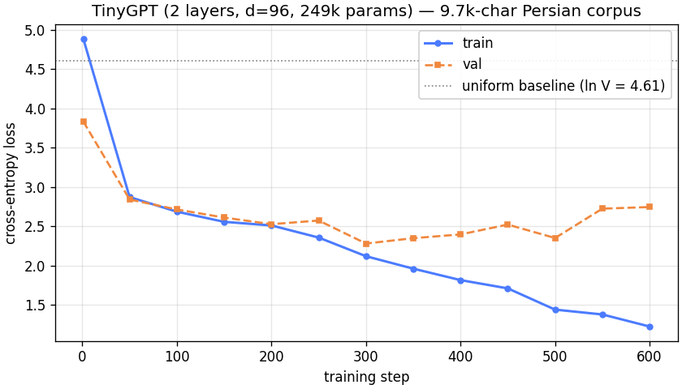

# TinyGPT from scratch

A Persian char-level transformer — **autograd engine, transformer blocks,
Adam optimizer and tokenizer — all written against raw NumPy**, with zero
ML frameworks. It trains on the same six Persian documents the RAG
assistant retrieves over, so the portfolio covers one corpus from two
directions: *use the model* (RAG) and *build the model* (this project).

## Architecture

| component | choice |
|---|---|
| autograd | tape-based reverse-mode engine; every op carries a hand-derived backward closure |
| tokens | characters — 100-symbol vocabulary (Persian + ZWNJ + punctuation + ASCII) |
| model | pre-LN decoder-only GPT: 2 blocks, d=96, 3 heads, context 64, ReLU FFN |
| parameters | 249,316 (float64) |
| optimizer | Adam with bias correction |
| training | 600 steps, batch 16 — **65 s on CPU** |

## Correctness is the feature

Hand-written autograd fails silently. Every primitive is pinned against
central-difference numerical gradients in the test suite — max errors
from the actual run are between **1e-10 and 4e-09** across add, mul,
matmul (2D + batched 3D), relu/tanh/exp, softmax (2D and attention 4D),
cross-entropy, gather and LayerNorm (including γ/β). The tests also pin
graph semantics: gradient *accumulation* across tensor reuse,
un-broadcasting back to parent shapes, and causal-mask isolation
(perturbing token *t* leaves earlier logits bit-identical).

Those checks caught two real bugs during development — a LayerNorm γ/β
reduction that summed the wrong axes, and graph reference cycles that
OOM-killed long training runs — both fixed in `src/autograd.py`.

## Results

Train loss falls **4.89 → 1.22** in 600 steps (uniform baseline
ln V = 4.61); validation lands at 2.74 — the gap after step ~300 is
memorisation of a 9.7k-char corpus, reported honestly. Generated text
shows learned word starts, ZWNJ morphology and punctuation rhythm:

```text
یادگیری عمیق مدل‌هایی برینگر تولید (Batch Sinelf-CNN) و شود چالش با نجامه عنا داست.
```



## Reproduce

```bash
cd tiny-gpt-from-scratch
pip install numpy pytest
python -m pytest tests/ -q          # 32 tests
python -m src.train --steps 600     # ~65 s
python -m src.generate --prompt "یادگیری ماشین" --chars 300
```
