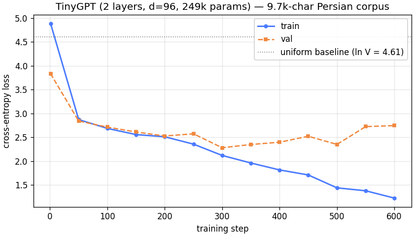

# 🧠 TinyGPT from Scratch — Persian char-level transformer, zero frameworks

[](https://huggingface.co/spaces/Abol0pati/tiny-gpt-fa)

**Try it live** — the committed 2 MB checkpoint runs in a browser demo
([Abol0pati/tiny-gpt-fa](https://huggingface.co/spaces/Abol0pati/tiny-gpt-fa)):
type a Persian prompt, tune temperature / top-k / seed, and watch the
char-level model continue it. The Space ships the same vendored
`src/` stack as this folder.

A complete language-modelling stack written against raw NumPy: a
**tape-based reverse-mode autograd engine**, a **decoder-only
transformer** (pre-LN blocks, causal multi-head attention, ReLU FFN),
**Adam**, a char-level tokenizer and a training/sampling CLI. No PyTorch,
no JAX, no TensorFlow — every gradient is either hand-derived in a
primitive's backward closure or composed automatically through the graph,
and every primitive is **verified against central-difference numerical
gradients** in the test suite.

It is trained on the same six Persian documents the
[`rag-farsi-assistant`](../rag-farsi-assistant/) retrieves over (snapshot
in `corpus/`, 9,665 chars) — so the two projects share one dataset and
answer one question from two directions: *can you build the model, not
just call it?*

## Results

| | |
|---|---|
| vocabulary | 100 characters (Persian + ZWNJ + punctuation + ASCII) |
| model | 2 blocks, d_model 96, 3 heads, context 64 |
| parameters | 249,316 (float64) |
| training | 600 Adam steps, batch 16 — **65 s on CPU** |
| final loss | train **1.22** · val **2.74** (uniform baseline ln V = 4.61) |



The train/val gap after step ~300 is memorisation of a 9.7k-char corpus
— reported honestly, because this project's claim is the *verified
machinery*, not SOTA text. Sample output (checkpoint from
`artifacts/params.npz`):

```text
یادگیری عمیق مدل‌هایی برینگر تولید (Batch Sinelf-CNN) و شود چالش با نجامه عنا داست.
رویکرد این کامپیوتر کتوم تنولی کاربرای مانند است؛ درچه با تواند برای وظارتی متفات دو اساز اجرا ...
```

Word starts, ZWNJ morphology («شده‌اند», «پیش‌بینی») and punctuation
rhythm are all learned — fluency needs orders of magnitude more data,
which is exactly the point the loss curve makes.

## Why the gradient checks matter

Hand-written autograd fails silently: a wrong backward closure still
produces plausible-looking training. The suite therefore pins every
primitive against central differences in float64 — max |analytic −
numeric| from the actual test run:

| primitive | max error | primitive | max error |
|---|---|---|---|
| add (broadcast) | 2.0e-10 | softmax | 1.1e-10 |
| mul (broadcast) | 1.1e-10 | softmax 4D (attention) | 5.4e-10 |
| matmul 2D | 1.7e-09 | cross-entropy | 3.8e-10 |
| matmul batched 3D | 4.5e-10 | gather (embedding) | 1.0e-09 |
| relu / tanh / exp | ~1e-10 | layer_norm (+γ/β) | < 1e-06 |

The engine also gets the subtle semantics right, by test:
**gradients accumulate across graph reuse** (`y = x*x + x` ⇒ `2x+1`),
broadcasting is *un-broadcast* back to each parent's shape (causal mask,
shared positional embeddings), and the causal mask provably isolates the
future (perturbing token *t* leaves logits < *t* bit-identical).

One real bug the checks caught during development: LayerNorm's γ/β
gradient reduction through broadcasting summarised the *wrong* axes —
the numeric check failed loudly, the fix (`_reduce_to`) is in
`src/autograd.py`. Also battle-tested: backward closures form reference
cycles, so `backward()` now tears the graph down after replaying
(`tests/` caught the OOM growth on long runs).

## Quick start

```bash
cd tiny-gpt-from-scratch
pip install -r requirements.txt        # numpy (+ pytest)

python -m pytest tests/ -q             # 32 tests — gradient checks first

python -m src.train --steps 600        # ~65 s CPU; writes artifacts/
python -m src.generate --prompt "یادگیری ماشین" --chars 300
```

## Project layout

```
tiny-gpt-from-scratch/
├── src/
│   ├── autograd.py     # Tensor + primitives + reverse-mode engine
│   ├── model.py        # Embedding/Linear/LayerNorm/Attention/Block/TinyGPT
│   ├── optimizer.py    # Adam (bias-corrected)
│   ├── tokenizer.py    # char-level, Persian-aware
│   ├── data.py         # corpus loading + batch sampling
│   ├── train.py        # CLI -> artifacts/{train_log.json, params.npz, ...}
│   └── generate.py     # CLI sampling from a checkpoint
├── corpus/             # the 6 Persian documents (same as the RAG corpus)
├── artifacts/          # committed: train_log.json, samples.txt, tokenizer.json
└── tests/              # 32 tests — numerical gradient checks + model semantics
```

See the root [README](../README.md) for the full portfolio; the
[evaluation docs](../docs/rag/evaluation.md) cover the retrieval side of
the same corpus.
